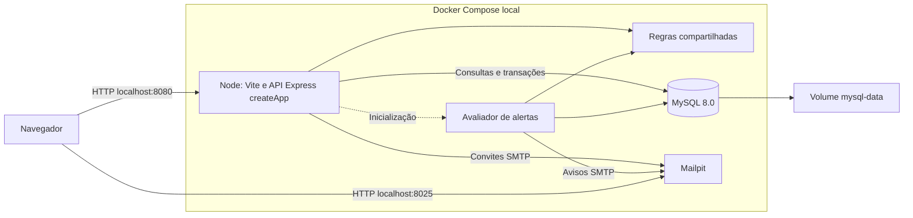
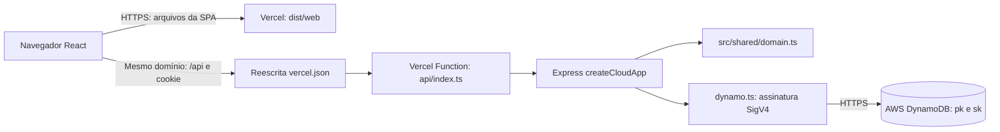
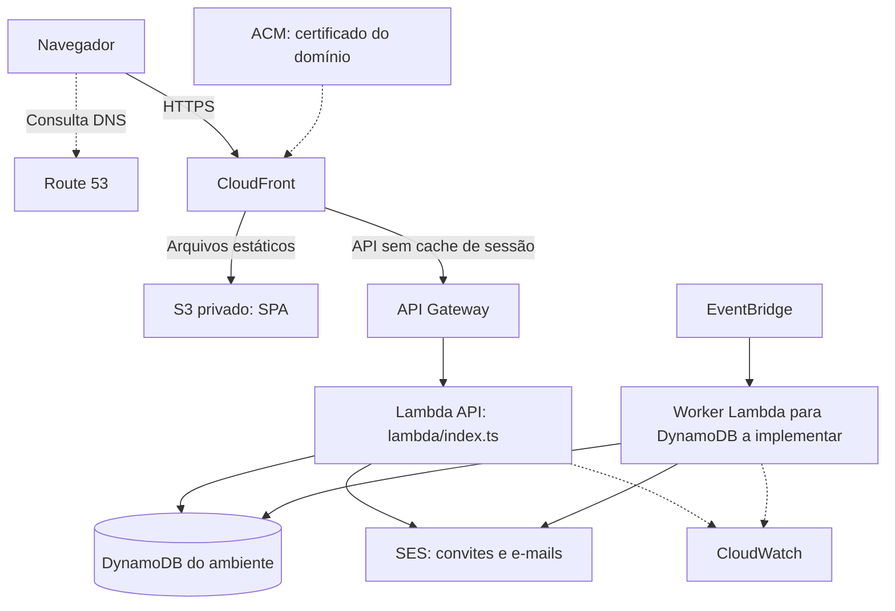
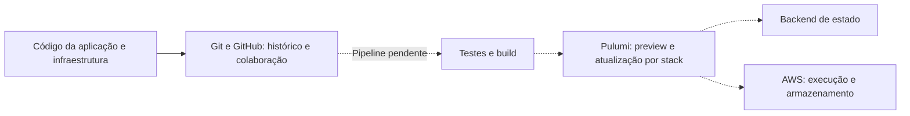
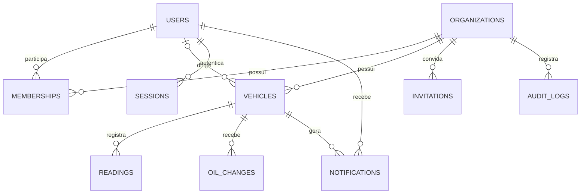

# Arquitetura do AutoKeep

Revisão da sprint 1 em 16/11/2026, baseada no código `ac69017`. Os diagramas representam código e configuração encontrados, sem comprovar execução em contas externas.

## Ambientes e responsabilidades

| Ambiente | Interface e entrada | Backend | Banco | Situação |
| --- | --- | --- | --- | --- |
| Local | Vite integrado ao Node, localhost:8080 | createApp em src/server/app.ts | MySQL 8.0 | Configurado no Compose |
| Publicação documentada | SPA dist/web na Vercel | api/index.ts e createCloudApp | DynamoDB | Documentado/configurado; deploy não verificado |
| AWS planejada | CDN, DNS e certificado | API Gateway e Lambda | DynamoDB por ambiente | Infraestrutura e integração pendentes |

As duas APIs compartilham regras em `src/shared/domain.ts`, mas diferem em persistência, auditoria e notificações. Os bancos não possuem sincronização automática.

## Blocos do ambiente local

`scripts/dev.mjs` inicia o Compose. O servidor aplica migrações, executa seed quando aplicável e inicia API, Vite e avaliador. O worker avalia ao iniciar e agenda a próxima execução 15 minutos após concluir a anterior. Aplicação e Mailpit são publicados no loopback; MySQL fica na rede interna do Compose. Esse ambiente não exige login AWS/Pulumi. O modo local não inicia com NODE_ENV=production.

## Blocos da publicação documentada

O README indica tabela `autokeep-dev` em `us-east-1`; a conta não foi consultada nesta revisão. Região, tabela e credenciais vêm de variáveis de ambiente; não publicar segredos no Git. Login usa bcrypt e sessão em cookie, não Cognito/JWT. Convites retornam link sem envio real de e-mail. As rotas de notificações retornam lista vazia e confirmação de leitura sem persistência; não há avaliador remoto ativo no código.

## Arquitetura AWS planejada

Todos os componentes abaixo são alvo de implementação/validação, não descrição de infraestrutura ativa.

DNS resolve nomes; não é proxy HTTP. A opção desenhada mantém interface e API no mesmo domínio para preservar sessões atuais. Manter o frontend na Vercel em vez de S3 é uma decisão a confirmar para a entrega. Cognito/OIDC é uma possibilidade futura, não uma integração já implementada.

`lambda/index.ts` adapta eventos HTTP para createCloudApp e `scripts/build-lambda.mjs` prepara o pacote. Esses arquivos não criam recursos AWS. O worker MySQL não pode ser publicado como worker DynamoDB sem adaptação.

## Git, Pulumi e AWS

Um push só publica se existir automação configurada. Pulumi Cloud guarda o estado; não executa o backend da aplicação. O programa da sprint 2 está em `infra/`, com DynamoDB e Route 53 por stack; registro e aplicação reais dependem de autenticação e domínio autorizado. O exemplo de bucket em `pulumi-start-aws` é histórico. Lambda/CDN/certificados ainda são alvo das próximas sprints.

## Modelo de dados

### MySQL local

Migrações em `db/` definem usuários, organizações, associações, veículos, leituras, trocas, sessões, convites, auditoria e notificações. O backend utiliza transações nas operações compostas.

Este resumo não substitui as restrições SQL: atribuição exige associação na mesma organização.

### DynamoDB da API de nuvem

Chaves atuais: `pk` e `sk`, em minúsculas. Os GSIs descritos na arquitetura antiga não são utilizados pelo adaptador atual.

| Partição pk | Sort key sk | Conteúdo |
| --- | --- | --- |
| USER#id | PROFILE, ORG#organizationId | Perfil e associações |
| EMAIL#email | USER | Localização de conta por e-mail |
| ORG#id | PROFILE, MEMBER#userId, CAR#vehicleId, AUDIT#... | Espaço e entidades |
| CAR#id | READING#..., OIL#... | Histórico |
| SESSION#hash | SESSION | Sessão, expiração e campo ttl |
| INVITE#hash | INVITE | Convite, validade e aceite |
| META | SEED | Controle da demonstração |

`dynamo.ts` usa GetItem, PutItem, DeleteItem e Query. Algumas criações têm condição, mas o adaptador não oferece transação multirregistro. Não presumir atomicidade equivalente ao MySQL. O campo ttl não comprova expiração automática configurada na tabela; o código verifica validade de sessões e convites.

## Segurança e limites

- Sessão de 12 horas, hash do token persistido e cookie HttpOnly/SameSite Strict. Secure depende da origem/configuração.
- Escritas exigem origem esperada e JSON. Associação, papel e visibilidade são verificados pela API.
- Respostas da API usam Cache-Control no-store; futuras configurações de CDN devem preservar dados privados.
- Auditoria e notificações não têm paridade completa entre backends. Mailpit é teste local; hardware OBD2, push e OAuth externo continuam pendentes.
- Regras de óleo, média e projeção estão em `src/shared/domain.ts`, descritas em [requisitos.md](requisitos.md).

## Documentos relacionados

- [Requisitos e regras](requisitos.md)
- [Casos de uso](casos-de-uso.md)
- [Fluxogramas](fluxogramas.md)
- [Contratos e diferenças dos ambientes](contratos-api.md)
- [Pendências das sprints](pendencias-sprints.md)
