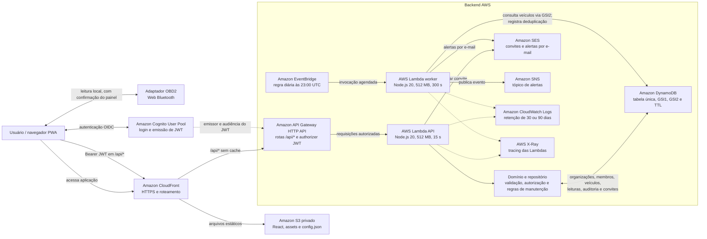

# Backend do AutoKeep na AWS

> **Referência histórica:** este diagrama descreve a estrutura anterior, removida
> do repositório no commit `ac69017`. Para os ambientes atuais e o alvo AWS ainda
> planejado, consulte [architecture.md](architecture.md). Os serviços abaixo
> não devem ser apresentados como implantação ativa da versão atual.

Este diagrama representa a infraestrutura definida em `infra/index.ts` e os fluxos implementados em `services/api/src`.

## Componentes e responsabilidades

| Bloco | Responsabilidade implementada |
| --- | --- |
| CloudFront e S3 | Servem a aplicação React/PWA de um bucket privado. O comportamento `/api/*` encaminha requisições ao API Gateway sem cache. |
| Cognito e API Gateway | O Cognito autentica o usuário; o authorizer JWT do HTTP API valida o token nas rotas de negócio. `GET /api/health` é público. |
| Lambda API | Trata organizações, membros, veículos, odômetro, trocas de óleo e convites. Os esquemas do pacote `@autokeep/domain` validam os dados; o repositório verifica associação e papel `ADMIN` ou `DRIVER`. |
| DynamoDB | Uma tabela por stack, com `PK`/`SK`. `GSI1` lista organizações de um usuário; `GSI2` lista veículos, inclusive para o worker. Convites têm TTL de sete dias; escritas transacionais gravam dados e auditoria. |
| EventBridge e Lambda worker | A regra `cron(0 23 * * ? *)` executa diariamente às 23:00 UTC. O worker projeta o odômetro no modo manual, avalia limites de distância e tempo, e registra uma chave de notificação para evitar repetição. |
| SES e SNS | O SES envia convites e alertas por e-mail. O worker publica o alerta no tópico SNS. |
| CloudWatch Logs e X-Ray | Guardam logs das duas Lambdas e habilitam rastreamento ativo. |

## Fluxos principais

1. O navegador carrega a SPA pelo CloudFront e autentica o usuário no Cognito.
2. A SPA envia o JWT em `/api/*`; o API Gateway valida o token e chama a Lambda API.
3. A Lambda extrai `sub` e `email` das claims, valida a entrada, consulta a associação à organização e lê ou grava no DynamoDB.
4. Convites são gravados com token armazenado como hash e enviados pelo SES. O token original é transmitido no fragmento do link e depois no corpo do POST de aceitação.
5. O EventBridge chama o worker todos os dias. Ele percorre veículos pela `GSI2`, calcula alertas e envia e-mail via SES e evento via SNS.

## Pontos de atenção identificados

- O tópico SNS recebe publicações, mas o repositório não configura assinaturas nem entrega remota Web Push. O service worker da PWA, por si só, não recebe esses eventos.
- O worker lê todos os veículos e os processa em sequência dentro de uma execução com limite de 300 segundos. Para uma frota grande, convém particionar o trabalho.
- O endpoint padrão do API Gateway permanece habilitado. Assim, clientes podem acessar a API diretamente, sem passar pelo CloudFront, embora as rotas de negócio ainda exijam JWT.
- A proteção de recuperação pontual e contra exclusão da tabela DynamoDB só é ativada na stack `prod`.
