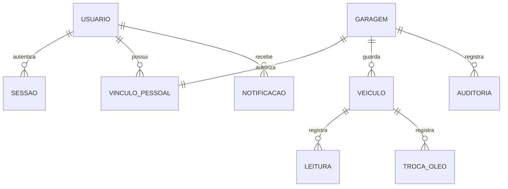
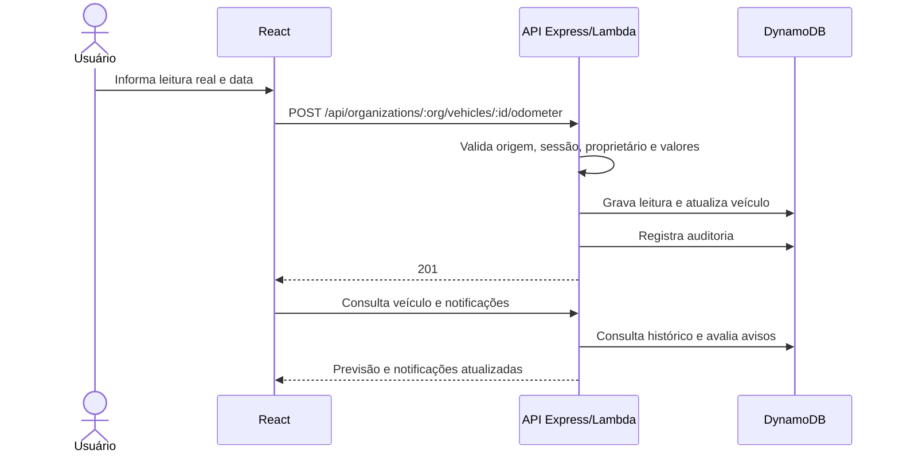

# Modelagem da garagem pessoal

Este documento descreve a implementação atual e substitui a especificação PDF
com escopo antigo e os diagramas estáticos anteriores. O histórico Git preserva
os documentos substituídos. O contrato de rotas está em
[openapi.local.yaml](openapi.local.yaml); os requisitos e pendências estão em
[milestone-audit.md](milestone-audit.md).

## Relações lógicas

Essas entidades são itens de uma única tabela DynamoDB por ambiente, não
tabelas relacionais. A interface usa uma garagem pessoal. O contrato mantém
`organizationId` e vínculo ADMIN para preservar os dados; não existe gestão
de equipe. A autorização exige vínculo de proprietário e garagem PERSONAL.

## Chaves no DynamoDB

| Partição pk            | Ordenação sk   | Conteúdo                                         |
| ---------------------- | -------------- | ------------------------------------------------ |
| USER#id                | PROFILE        | Nome e e-mail do usuário                         |
| USER#id                | ORG#garagem    | Associação à garagem pessoal                     |
| ORG#garagem            | PROFILE        | Nome e tipo PERSONAL                             |
| ORG#garagem            | MEMBER#usuario | Proprietário interno ADMIN                       |
| ORG#garagem            | CAR#veiculo    | Cadastro, hodômetro, última troca e arquivamento |
| ORG#garagem            | AUDIT#…        | Operação, ator, veículo e data                   |
| CAR#veiculo            | READING#…      | Quilometragem, data, origem MANUAL/OBD2 e ator   |
| CAR#veiculo            | OIL#…          | Quilometragem, data, óleo e ator                 |
| EMAIL#endereco         | USER           | Índice de e-mail para usuário                    |
| OIDC#hash              | USER           | Identidade Google para usuário                   |
| SESSION#hash           | SESSION        | Usuário, expiração e TTL                         |
| OAUTH#hash             | GOOGLE         | State, nonce, PKCE e expiração da tentativa      |
| NOTIFY#garagem#usuario | NOTICE#hash    | Notificação persistida e leitura                 |
| WEB_PUSH               | SUB#hash       | Inscrição opcional do dispositivo                |
| PUSH#inscricao#usuario | NOTICE#hash    | Controle de entrega opcional de push             |

Somente o hash do token de sessão é persistido. Expiração é validada pela API;
TTL é uma limpeza auxiliar, sem garantia de remoção imediata. A tentativa OAuth
é consumida uma única vez. Nenhuma senha é necessária no fluxo atual.

## Sequência de uma leitura

O cadastro da identidade Google usa uma transação. Operações de manutenção
fazem múltiplas escritas; os testes sequenciais não comprovam atomicidade sob
concorrência. Essa limitação deve ser tratada antes de adicionar ingestão
contínua/automática de leituras.

## Regras implementadas

- Óleo mineral: 5.000 km; semissintético: 8.000 km; sintético: 12.000 km.
- Prazo temporal: 365 dias; vale o primeiro limite atingido.
- Aviso preventivo: até 500 km ou 30 dias restantes.
- Média diária calculada pelo intervalo entre a primeira e a última das três
  leituras reais mais recentes, com intervalo mínimo de um dia.
- Hodômetro previsto é estimativa; não substitui o valor real informado.
- Calibração solicitada em modo manual com menos de três leituras e pelo menos
  30 dias desde a última atualização.
- Arquivamento oculta o veículo e preserva histórico e auditoria.
- Notificações no app são avaliadas sob demanda; não existe envio real de e-mail.

Novas leituras e veículos aceitam somente entrada manual. A origem OBD2 é
preservada apenas na tipagem e nos registros legados.
GPS, Bluetooth automático e offline mobile são propostas, não capacidades
publicadas; veja [estudo mobile](gps-study.md).
