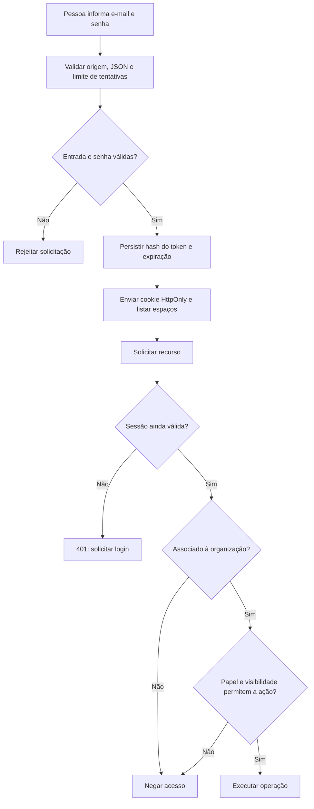
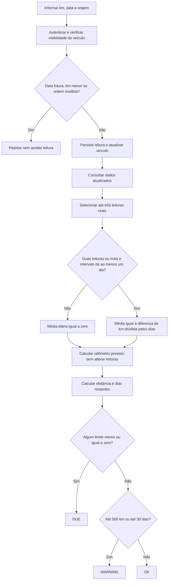
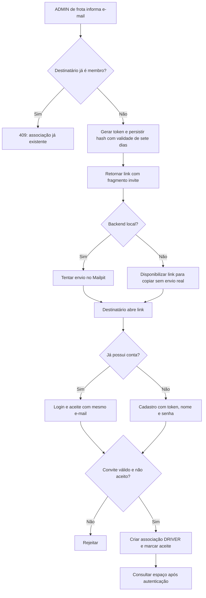
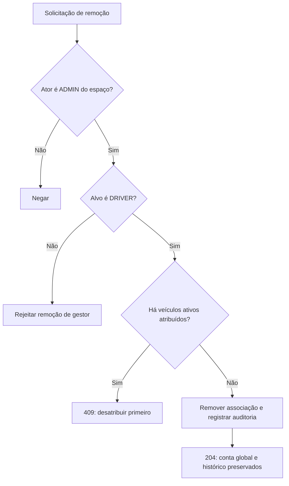
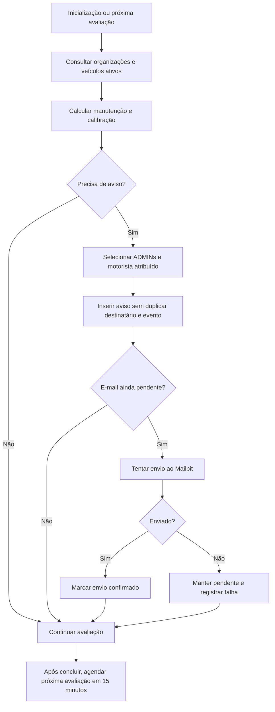

# Fluxogramas — AutoKeep

Revisão da sprint 1 em 16/11/2026. Diagramas Mermaid derivados dos fluxos atuais. A intenção funcional não representa teste de concorrência ou comprovação de deploy.

## Autenticação e autorização — UC-01 a UC-10

Rotas públicas de login, cadastro por convite e saúde não exigem uma sessão prévia. A autorização de organização/recurso se aplica às rotas correspondentes, não a toda requisição.

## Leitura real e recálculo — UC-04 e UC-06

Distância utiliza a projeção; o limite temporal é de 365 dias desde a última troca. No modo MANUAL, calibração é sinalizada com menos de três leituras e pelo menos 30 dias desde a última atualização.

## Convite — UC-07

O desenho expressa a regra de uso único. No MySQL o aceite usa transação/bloqueio; o DynamoDB atual faz operações separadas e precisa de validação de concorrência.

## Remover motorista — UC-09

## Avaliador de alertas local — UC-11

Esse worker utiliza MySQL e SMTP local. Não há agendamento remoto implementado; as rotas de notificações no backend DynamoDB ainda são provisórias. Uma interrupção entre envio e confirmação pode duplicar e-mail.
